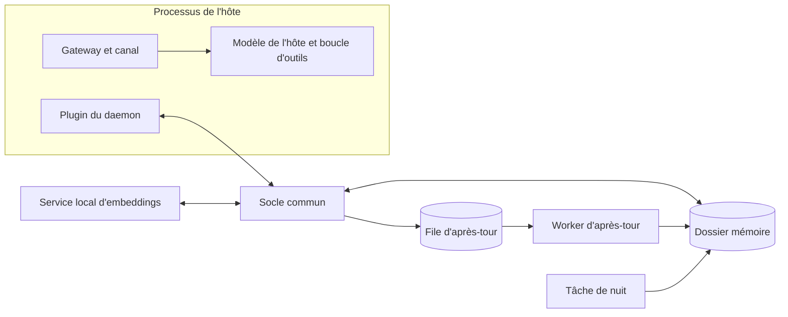

# Architecture

[English](architecture.md) · **Français**

Daemon Harness donne à un hôte d'agent un assistant personnel durable : une voix
stable, une mémoire Markdown qui appartient à l'utilisateur et une lecture de
la situation présente. Chaque composant, chaque étape d'un tour et chaque
règle est décrit ci-dessous avec le code qui le met en œuvre ;
l'[aperçu](overview.fr.md) en donne le tour rapide.

## Les termes

| Terme | Sens |
| --- | --- |
| **Daemon** | L'assistant personnel de l'utilisateur : son identité, sa mémoire et sa continuité. |
| **Hôte** | Le programme d'agent sur lequel le daemon fonctionne, Hermes Agent ou OpenClaw. Il possède le modèle, les canaux, les sessions, l'affichage progressif des réponses et les outils. |
| **Gateway** | Le processus permanent de l'hôte qui reçoit les messages d'un canal (par exemple Telegram) et envoie les réponses. |
| **Tour** | Un message de l'utilisateur et la réponse qui lui est faite. |
| **L0** | Le niveau brut de l'historique de conversation (*Level 0*, aussi appelé *Ground Zero*) : chaque message copié mot pour mot, avec sa date et son auteur, dans des fichiers où l'on ne fait qu'ajouter. |
| **Souvenir** | Une note Markdown de la mémoire sur un sujet durable, avec son histoire et ses sources. Les souvenirs sont rangés dans cinq dossiers appelés [PARGA](parga.fr.md). |
| **Scène** | Une note de travail qui décrit la situation présente (établi, supposé, incertain, échéances ouvertes), réécrite après chaque échange et qui cite ses sources. Dans le code : *Scene Model*. |
| **Projection** | Tout fichier dérivé des sources exactes (scène, état de la conversation, index, embeddings). Une projection peut être recalculée et ne prouve jamais un fait à elle seule. |
| **Après-tour** | L'entretien de la mémoire fait après une réponse, en dehors de la conversation. |
| **File** (*spool*) | Le dossier des tâches d'après-tour en attente. Une tâche contient des références vers des entrées de L0, pas une copie de la conversation. |
| **Worker** | Le processus d'arrière-plan qui vide la file. |
| **Reçu** | Une trace technique qu'une étape de traitement a eu lieu. Ce n'est pas la preuve d'un fait personnel. |
| **Embedding** | Une représentation numérique du sens d'un texte, qui sert à classer les souvenirs par proximité. |

## Les règles de conception

Six règles façonnent tous les composants.

1. **Une seule voix.** Le modèle de l'hôte est le seul qui parle. Le daemon
   n'ajoute aucun appel au modèle avant la réponse, aucun programme qui choisit
   une réponse, aucun second modèle qui la réécrit.
2. **L'hôte garde ses capacités.** Le canal, la session, le modèle,
   l'affichage, les outils et leurs autorisations restent ceux de l'hôte. Le
   daemon ne modifie jamais le code de l'hôte : il s'y branche par ses propres
   interfaces d'extension.
3. **Le code borne, le modèle juge.** Du code déterministe vérifie chemins,
   tailles, dates, provenances, états de file et écritures atomiques. Le sens
   d'un message est jugé par un modèle. Aucune règle par mots-clés ne décide
   qu'une phrase doit créer, modifier ou archiver une note.
4. **Le Markdown exact fait autorité.** L0 et les fichiers Markdown sont les
   sources. Chaque projection renvoie vers eux et peut être reconstruite à
   partir d'eux.
5. **Le chemin visible reste léger.** Le travail coûteux se fait après la
   réponse ou la nuit. Une panne interne est reprise ou se dégrade proprement ;
   elle ne bloque pas la conversation.
6. **Les deux hôtes partagent un seul socle.** Composition, mémoire, règles de
   preuve et outils mémoire sont les mêmes pour Hermes et OpenClaw. Seul le
   code d'adaptation à chaque hôte diffère.

## Les composants



| Composant | Ce qu'il fait | Comment il tourne | Code |
| --- | --- | --- | --- |
| **Socle commun** | Compose le contexte d'un tour, lit et écrit la mémoire, exécute les jugements d'après-tour et l'entretien de nuit. | Une bibliothèque Python, chargée par tous les autres composants. | [`src/daemon_core/`](../src/daemon_core/) |
| **Plugin mémoire Hermes** (`daemon_core`) | Prépare chaque tour, inscrit les deux messages dans L0, dépose la tâche d'après-tour et sert les deux outils mémoire. | Dans la gateway Hermes, comme fournisseur de mémoire externe de Hermes. | [`integrations/hermes_plugin/`](../integrations/hermes_plugin/) |
| **Plugin de voix Hermes** (`daemon_voice`) | Remplace les consignes système et l'historique de chaque requête au modèle par le contexte composé, à chaque étape de la boucle d'outils. | Dans la gateway Hermes, comme intermédiaire des appels au modèle. | [`integrations/hermes_voice_plugin/`](../integrations/hermes_voice_plugin/) |
| **Plugin OpenClaw** | Fournit le contexte composé au modèle d'OpenClaw, expose les deux outils mémoire et signale chaque tour terminé. | Dans OpenClaw (Node.js), comme moteur de contexte. | [`integrations/openclaw_plugin/`](../integrations/openclaw_plugin/) |
| **Pont local** | Relie le plugin OpenClaw, écrit en JavaScript, au socle Python. | Un serveur HTTP local, joignable seulement depuis le même ordinateur. | [`server/`](../server/) |
| **Worker d'après-tour** | Traite la file : jugements, écritures en mémoire, révision de la scène. | Un service d'arrière-plan permanent. | [`after_turn_daemon.py`](../src/daemon_core/after_turn_daemon.py), [`after_turn_spool.py`](../src/daemon_core/after_turn_spool.py) |
| **Tâche de nuit** | Nettoyage de l'agenda, Dreaming et REM. | Une tâche planifiée, chaque jour à 4 h dans une installation par l'app. | [`nightly_maintenance.py`](../src/daemon_core/nightly_maintenance.py) |
| **Service d'embeddings** | Calcule les embeddings de l'index des souvenirs avec Qwen3-Embedding 0.6B. | Un serveur local privé, distinct du modèle qui écrit les réponses. | [`semantic_atlas.py`](../src/daemon_core/semantic_atlas.py) |
| **Companion** | Installe un hôte, les plugins, le dossier mémoire et les services, puis les gère. | Une application de bureau. Elle ne participe à aucun tour. | [`apps/companion/`](../apps/companion/README.md) |

## Un tour, étape par étape

### 1. L'hôte reçoit le message

La gateway reçoit le message depuis le canal et commence son traitement
habituel. Rien n'a été placé devant elle.

### 2. Le daemon prépare le contexte

L'adaptateur appelle la préparation commune,
[`prepare_turn`](../src/daemon_core/turn_runtime.py), qui inscrit le message
de l'utilisateur dans L0 et construit les messages que le modèle lira
([`canonical_voice.py`](../src/daemon_core/canonical_voice.py),
[`thin_sovereign.py`](../src/daemon_core/thin_sovereign.py)). La préparation
lit des fichiers et les assemble ; elle n'appelle aucun modèle de langage. Son
seul appel extérieur va au service local d'embeddings, borné à 10 secondes.

- **Sur Hermes**, le plugin mémoire prépare le tour quand Hermes demande du
  contexte à son fournisseur de mémoire. Le plugin de voix réécrit ensuite la
  requête au modèle : il remplace les consignes système et l'historique de
  Hermes par le contexte composé, et le rétablit à chaque étape de la boucle
  d'outils.
- **Sur OpenClaw**, le plugin interroge le pont (`POST /openclaw/assemble`).
  OpenClaw garde son propre historique de conversation ; le plugin y ajoute
  seulement les messages récents de L0 qui y manquent, sans doublon.

Le contexte est détaillé plus bas, dans [Ce que le modèle lit](#ce-que-le-modèle-lit).

### 3. Le modèle de l'hôte répond

Le modèle tourne dans la boucle propre à l'hôte, avec son affichage. Il peut
appeler les outils de l'hôte et les deux outils mémoire :

- `daemon_read_souvenirs` ouvre jusqu'à huit souvenirs en entier ;
- `daemon_recall_l0` cherche dans L0 une parole passée exacte quand les
  souvenirs ne suffisent pas.

Sur Hermes, les outils s'exécutent dans le processus du plugin ; sur OpenClaw,
ils passent par le pont (`POST /openclaw/tool`).

Le daemon remplace la mémoire personnelle propre à l'hôte : les outils de
mémoire natifs de l'hôte sont donc masqués, `memory` sur Hermes,
`memory_search` et `memory_get` sur OpenClaw. Sur Hermes, l'outil d'extraction
de pages Web est aussi masqué quand aucun moteur d'extraction n'est configuré,
car chaque appel échouerait. Tous les autres outils sont ceux de l'hôte, et le
daemon ne les retire, ne les limite ni ne les ordonne. Il pose une règle de
preuve : un résultat vide, bloqué, partiel ou ambigu ne confirme pas un fait.

### 4. La réponse est inscrite et la tâche d'après-tour déposée

Une fois la réponse envoyée, l'adaptateur l'inscrit dans L0 et ajoute une
tâche à la file. La tâche contient les références des deux entrées de L0 (le
message et la réponse) et les souvenirs lus pendant le tour. Sur Hermes, cela
se fait dans le plugin mémoire ; sur OpenClaw, par `POST /openclaw/ingest`.

### 5. Le worker entretient la mémoire

Le worker traite la tâche un instant plus tard, comme décrit dans
[Après la réponse](#après-la-réponse). La conversation ne l'attend pas.

## Ce que le modèle lit

La requête composée a quatre parties, dans cet ordre.

**1. Un message système**, fait de ces sections :

| Section | Contenu | Source |
| --- | --- | --- |
| Identité | Le nom et le genre grammatical du daemon. | `core/daemon_identity.json`, écrit à l'installation ; sinon le réglage `DAEMON_CORE_AGENT_NAME` ; sinon `Daemon`. |
| Voix et manière | La personnalité du daemon et sa manière de converser. | `persona.md`, `conversation.md` |
| Repères personnels stables | Les faits personnels durables utiles à chaque conversation ; pendant les premiers échanges, aussi les consignes d'accueil et les préférences données à l'installation. | `users/<id>/context.md` |
| Contrat du tour | Comment répondre : à l'échelle du message et depuis le dialogue exact. Le modèle écrit d'abord une ligne masquée, `[daemon-turn: mode]`, qui l'engage sur un mouvement : partager (`exchange`), répondre (`direct`), poser une seule question (`clarify`) ou avancer sous une condition énoncée (`condition`). Le transport retire cette ligne avant l'affichage. | Texte fixe |
| Cadre temporel | La date et l'heure du message, et l'âge de la scène. | Calculé |
| Situation | La scène ; sans scène valide, un *point de départ* : le contexte en cours, l'agenda et l'état de la conversation, présentés comme datés et révisables. | Fichier de scène, ou `contexte_actif.md`, `agenda.md`, `conversation_state.md` |
| Passé récent exact | Des extraits exacts des jours précédents, au plus 6 000 caractères sur deux jours. | L0 |
| Épisode passé pertinent | Un épisode écrit par REM, quand les premiers candidats de l'index s'accordent sur lui ; présenté comme passé, jamais comme le présent. | `Archives/Episodes` |
| Repères en cours | Les faits du contexte en cours que la scène ne couvre pas encore. | `contexte_actif.md` |
| Sources actuelles | Avec une scène, l'agenda, qui l'emporte sur la scène en cas de désaccord. | `agenda.md` |
| Souvenirs déjà ouverts | Les souvenirs que la scène garde sous la main, plus ceux lus lors de tours récents que le worker n'a pas encore traités ; au plus huit et 50 000 caractères. | Fichiers des souvenirs |
| Catalogue | Jusqu'à douze souvenirs suggérés par l'index, listés par chemin dans l'ordre de pertinence estimée et présentés comme des pistes, pas des faits. | Index |
| Outils | Le mode d'emploi des outils mémoire et des outils de l'hôte. | Texte fixe |

Quand le catalogue contient des entrées *Common Ground* (des épisodes d'un
langage construit avec l'utilisateur, comme une expression privée), une règle
de lecture propre à ces entrées est ajoutée.

**2. Le dialogue récent** : les derniers messages, jusqu'à 24, mot pour mot
depuis L0, chacun comme un message distinct.

**3. Un seuil du tour** : un court message système placé juste avant celui de
l'utilisateur. Il demande au modèle de composer toute la situation avant de
décider, d'ouvrir une preuve quand un fait personnel manque, et de vérifier un
sujet extérieur avant de parler de son contenu.

**4. Le message de l'utilisateur.**

### L'index des souvenirs

L'index ([`semantic_atlas.py`](../src/daemon_core/semantic_atlas.py)) compare
le message, et les quatre derniers messages, au corps de chaque souvenir et à
ses propriétés (`subjects`, `facets`). Il garde au plus douze souvenirs. Les
embeddings sont conservés sur disque et recalculés seulement pour les souvenirs
qui ont changé ; après une écriture en mémoire, le cache est mis à jour en
arrière-plan.

L'index ne fait que classer des chemins. Le modèle doit ouvrir un souvenir
avant d'utiliser ce qu'il dit. Si le service d'embeddings ne répond pas dans
sa borne, le catalogue liste à la place tous les souvenirs actifs, et
l'incident est noté dans les journaux.

## Après la réponse

### La file

La file ([`after_turn_spool.py`](../src/daemon_core/after_turn_spool.py)) est
un dossier de fichiers JSON, un par tâche, qui survit aux redémarrages de
l'hôte et du worker.

- Les tâches sont traitées dans l'ordre, par hôte, par un seul worker qui
  détient un verrou exclusif.
- Une tâche en cours est *réservée* pour 30 minutes ; si le worker s'arrête,
  elle redevient disponible.
- Une étape en échec est reprise jusqu'à trois fois, avec un délai qui part de
  5 secondes et double jusqu'à 5 minutes. Ensuite, la tâche reste dans l'état
  `failed` avec son erreur, pour diagnostic.
- Un fichier de tâche illisible est mis en quarantaine au lieu d'être
  supprimé.
- Le worker publie un signal de vie technique, sans texte de conversation.

### Les jugements de chaque tour

Chaque tour est reconstitué depuis ses références L0, puis passe par trois
jugements d'un modèle, dans l'ordre ([`loop.py`](../src/daemon_core/loop.py)) :

1. **Le Radar** ([`context_router.py`](../src/daemon_core/context_router.py)).
   Il reçoit le message, le dialogue récent, l'agenda, le contexte en cours,
   les faits stables et la carte des souvenirs existants (noms et propriétés,
   pas leur contenu). Il ne répond jamais à l'utilisateur et n'écrit rien. Sa
   réponse commande la suite :
   - la **profondeur** de l'échange : un échange léger (un accord, un merci,
     un fil qui continue sans rien de nouveau) ne lance pas MemoryAgent ;
   - les **souvenirs candidats** concernés, que MemoryAgent lit en entier ;
   - si une **date, une échéance ou une routine** a été apportée ou corrigée,
     ce qui lance Temporal Curator.
2. **Temporal Curator** ([`temporal_memory.py`](../src/daemon_core/temporal_memory.py))
   met l'agenda personnel à jour quand le Radar le demande.
3. **MemoryAgent** ([`memory_agent.py`](../src/daemon_core/memory_agent.py))
   lit le message, la réponse, le dialogue récent et les souvenirs candidats,
   puis propose de créer, compléter ou corriger des souvenirs et les fichiers
   de contexte courts. Le code vérifie chaque proposition avant de l'écrire :
   la citation qui sert de preuve doit figurer dans le message exact de
   l'utilisateur, le fichier ne doit pas avoir changé depuis sa lecture, et
   rien de ce qui était écrit ne doit être perdu. MemoryAgent peut aussi
   déplacer un souvenir vers un autre dossier PARGA après un nouveau message
   de l'utilisateur qui le justifie ([`note_relocation.py`](../src/daemon_core/memory/note_relocation.py)).

### Les projections remplaçables, une fois par série de messages

Quand plusieurs messages arrivent rapprochés, le travail entièrement réécrit à
chaque fois est fait une seule fois pour toute la série
([`after_turn_executor.py`](../src/daemon_core/after_turn_executor.py)) :

- le **jugement de relance** ([`relanceur.py`](../src/daemon_core/relanceur.py))
  décide si le daemon doit revenir plus tard sur un sujet, quand et sous quel
  angle. Il peut d'abord calculer la **trajectoire** de l'utilisateur, un court
  récit de ce qu'il traverse en ce moment ([`narrator.py`](../src/daemon_core/narrator.py)).
  L'hôte programme et délivre la relance ; au moment de l'envoi, un dernier
  jugement relit ce qui a été dit depuis et peut l'annuler ;
- la **révision de la scène** ([`scene_model.py`](../src/daemon_core/scene_model.py))
  écrit une seule nouvelle scène qui couvre tous les messages de la série
  (jusqu'à 64 messages, 16 000 octets ou 3 minutes d'attente). L'ancienne
  scène reste en usage tant que la nouvelle n'est pas valide ;
- l'**état de la conversation** est ensuite dérivé de la nouvelle scène, sans
  autre appel au modèle ;
- le **cache de l'index** est mis à jour si des souvenirs ont changé.

Les faits de chaque message ne sont jamais fusionnés : seules ces projections
le sont.

Chaque étape terminée écrit un reçu ([`continuity.py`](../src/daemon_core/continuity.py)) :
une tâche reprise sait ainsi ce qui est déjà fait et ne répète pas une écriture
en mémoire.

## La nuit

La tâche de nuit ([`nightly_maintenance.py`](../src/daemon_core/nightly_maintenance.py))
tourne pour chaque utilisateur :

1. **Nettoyage de l'agenda** ([`agenda_maintenance.py`](../src/daemon_core/agenda_maintenance.py)) :
   les lignes dont la date est passée vont, octet pour octet, dans une archive
   datée, sans affirmer que l'événement a eu lieu.
2. **Dreaming** ([`dreaming.py`](../src/daemon_core/dreaming.py)), s'il y a eu
   de l'activité ou si un passage précédent doit être repris : il relit les
   souvenirs écrits pendant les dernières 48 heures en les comparant aux
   messages exacts dont ils viennent, et les corrige ou fusionne les doublons
   avec prudence. Il n'écrit jamais l'agenda.
3. **REM** ([`rem.py`](../src/daemon_core/rem.py), [`episodic_rem.py`](../src/daemon_core/episodic_rem.py)),
   dans les mêmes conditions : il écrit le récit d'épisodes passés, sourcé par
   L0, dans `Archives/Episodes`. Ses interprétations restent des lectures du
   passé.

Une étape en échec est notée comme incomplète et reprise la nuit suivante ;
elle n'est jamais présentée comme une réussite.

## Qui écrit quoi

Chaque fichier a un seul propriétaire automatique. Les autres composants
peuvent le lire, pas l'écrire.

| Fichier | Écrit par | Jamais écrit par |
| --- | --- | --- |
| L0 | Les adaptateurs des hôtes, en ajout seulement, chaque entrée une fois. | Aucun jugement : L0 n'est jamais résumé, corrigé ni effacé. |
| `persona.md` | MemoryAgent, seulement quand l'utilisateur demande explicitement de changer l'identité ou le caractère du daemon ; l'utilisateur. | Tout autre jugement. |
| `conversation.md` | L'utilisateur seulement. | Tous les composants automatiques. |
| `context.md`, `contexte_actif.md`, `focus_immediat.md` | MemoryAgent après un tour ; Dreaming, avec prudence, la nuit. | Temporal Curator, REM, la scène. |
| `agenda.md` | Temporal Curator pour son sens ; le nettoyage de nuit archive seulement les lignes passées. | MemoryAgent, Dreaming, REM, la scène, un outil calendrier de l'hôte. |
| Souvenirs | MemoryAgent pour les faits d'un tour ; Dreaming pour l'entretien de nuit. | L'index, qui ne fait que suggérer. |
| Épisodes de `Archives/Episodes` | REM. | MemoryAgent et Dreaming. |
| Scène | La révision de scène, avec des sources vérifiées. | Tout autre jugement ; Dreaming peut seulement invalider une scène après une réparation. |
| État de la conversation | Dérivé de la scène. | — |
| Index et cache d'embeddings | Reconstruits après les écritures autorisées en mémoire. | — (ils ne sont jamais une preuve). |
| File | Les adaptateurs ajoutent des tâches ; le worker les traite. | — (elle contient des références, jamais des faits personnels). |

## Ce qui fait foi

| Source | Ce qu'elle établit |
| --- | --- |
| Le message actuel | Ce que l'utilisateur affirme ou demande maintenant. Il l'emporte sur toute projection. |
| L0 | Ce qui a été dit, exactement, par qui et quand. |
| Un souvenir ouvert | Un fait personnel durable, dans sa portée et sa période. |
| `agenda.md` | Un engagement ou une échéance confiés par l'utilisateur, pas le fait qu'ils aient eu lieu. |
| Le résultat d'un outil de l'hôte | Ce que ce résultat contient, au moment où il a été obtenu. |
| La scène | Une lecture du présent, sourcée et révisable. |
| L'index | Rien : une liste de souvenirs à ouvrir. |
| Une réponse précédente du daemon | Seulement ce que le daemon a dit, sauf si l'utilisateur l'a confirmé. |

## Où vivent les données

```text
<dossier mémoire>                  à ouvrir dans Obsidian
├── Projects/ Areas/ Resources/    les souvenirs (voir PARGA)
├── Garden/ Archives/              Archives/Episodes contient les épisodes de REM
└── .daemon/                       état interne, pas un cache jetable
    ├── core/daemon_identity.json  nom et genre
    ├── levels/L0_ground_zero/     L0
    └── users/<id>/                context.md, agenda.md, contexte_actif.md,
                                   focus_immediat.md, conversation_state.md,
                                   scènes et autres états par utilisateur
```

La file, les reçus et le cache d'embeddings se trouvent dans le dossier d'état
privé de l'installation, hors du dossier mémoire ; leurs emplacements sont des
réglages (`DAEMON_CORE_AFTER_TURN_SPOOL_DIR`,
`DAEMON_CORE_CONTINUITY_RECEIPT_DIR`, `DAEMON_CORE_ATLAS_EMBEDDING_CACHE`).
L'hôte, le pont et le worker doivent utiliser les mêmes chemins. Voir la
[configuration](configuration.md) (en anglais).

Une sauvegarde doit inclure tout le dossier mémoire, `.daemon` compris. L'index
et les embeddings peuvent être reconstruits ; L0 ne peut pas l'être à partir
des souvenirs.

## Quand quelque chose échoue

| Panne | Ce qui se passe |
| --- | --- |
| La préparation échoue, ou le pont OpenClaw est injoignable | L'hôte répond avec son propre contexte et ses outils, plus une consigne fixe : n'affirmer aucun fait personnel absent du dialogue visible. La réponse commence par l'avis « ⚠️ System notice · Personal memory was unavailable for this response. », ajouté par le transport et non par le modèle, puis retiré avant que la réponse soit inscrite dans L0. |
| Pas de scène valide | Le modèle répond depuis le point de départ. |
| Service d'embeddings indisponible | Le catalogue liste tous les souvenirs actifs ; l'incident est noté dans les journaux. |
| Un jugement d'après-tour échoue | La tâche est reprise, puis gardée dans l'état `failed` avec son erreur. La conversation continue ; rien n'est montré à l'utilisateur. |
| Une étape de nuit échoue | Elle est notée comme incomplète et reprise la nuit suivante. |

**Santé et disponibilité.** Le pont expose `/health`, qui dit seulement que le
processus tourne, et `/ready`, qui vérifie aussi que le code, le dossier
mémoire et le worker attendus sont en place. Un processus qui tourne ne
prouve ni l'un ni l'autre. Pour vérifier une installation, vérifier aussi une
vraie conversation et la fin de sa tâche d'après-tour. Voir
l'[exploitation](operations.md) (en anglais).

## Ajouter un hôte

Un nouvel adaptateur d'hôte se place dans `integrations/` et doit :

- garder le modèle de l'hôte comme seule voix, et les outils de l'hôte comme
  les siens ;
- appeler `prepare_turn` et transmettre ses messages au modèle sans les
  modifier ;
- inscrire les deux messages dans L0 une seule fois et déposer une tâche par
  tour ;
- exposer `daemon_read_souvenirs` et `daemon_recall_l0` avec les contrats
  communs ;
- appliquer le mode dégradé ci-dessus quand la préparation échoue.

La parité se démontre sur la lecture, l'écriture, le transport et le travail
d'arrière-plan, pas seulement par une réponse finale plausible.

## Pour aller plus loin

- [Le daemon en un coup d'œil](overview.fr.md) : le tour rapide.
- [PARGA : le classement de la mémoire](parga.fr.md).
- [Référence de la mémoire](memory_structure_developer_guide.md) : formats des
  souvenirs, provenance, déplacements.
- [Configuration](configuration.md) (en anglais) : chemins, identité, rôles
  des modèles et réglages.
- [API HTTP locale](bridge-api.md) (en anglais) : les points d'accès du pont.
- [Contrat du worker d'après-tour](../integrations/after_turn_service/README.md)
  (en anglais).
- [Exploitation et dépannage](operations.md) (en anglais).
