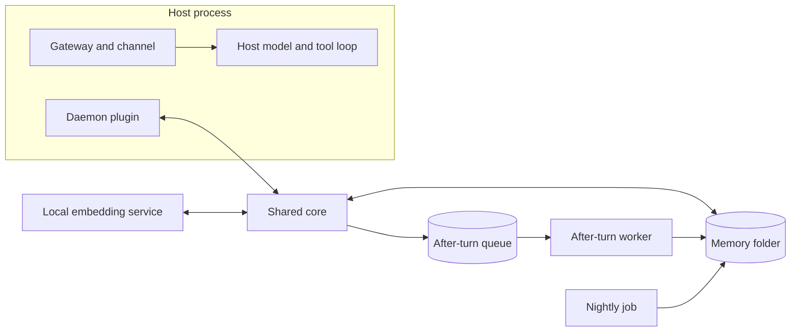

# Architecture

**English** · [Français](architecture.fr.md)

Daemons gives an agent host a persistent personal assistant: a stable voice,
a Markdown memory that belongs to the user, and a reading of the present
situation. Each component, each step of a turn and each rule is described
below with the code that implements it; the [overview](overview.md) gives the
short tour.

## Terms

| Term | Meaning |
| --- | --- |
| **Daemon** | The user's personal assistant: its identity, memory and continuity. |
| **Host** | The agent program the daemon runs on, Hermes Agent or OpenClaw. It owns the model, channels, sessions, streaming and tools. |
| **Gateway** | The host's long-running process that receives messages from a channel (for example Telegram) and sends replies. |
| **Turn** | One user message and the reply to it. |
| **L0** | The raw level of the conversation history (*Level 0*, also called *Ground Zero*): every message copied word for word, with its date and author, in append-only files. |
| **Souvenir** | A Markdown memory note about one lasting subject, with its history and sources. Souvenirs are filed in five folders called [PARGA](parga.md). |
| **Scene** | A working note describing the present situation (established, inferred, uncertain, open deadlines), rewritten after each exchange and citing its sources. In the code: *Scene Model*. |
| **Projection** | Any file derived from the exact sources (scene, conversation state, index, embeddings). A projection can be recomputed and never proves a fact on its own. |
| **After-turn** | The memory maintenance done after a reply, outside the conversation. |
| **Queue** (*spool*) | The folder of after-turn jobs waiting to be processed. A job holds references to L0 entries, not a copy of the conversation. |
| **Worker** | The background process that empties the queue. |
| **Receipt** | A technical record that a processing stage took place. It is not evidence of a personal fact. |
| **Embedding** | A numerical representation of a text's meaning, used to rank souvenirs by similarity. |

## Design rules

Six rules shape every component.

1. **One voice.** The host's model is the only one that speaks. The daemon
   adds no model call before the reply, no router choosing an answer and no
   second model rewriting it.
2. **The host keeps its capabilities.** The channel, session, model,
   streaming, tools and their permissions stay the host's. The daemon never
   modifies the host's source code: it plugs in through the host's own plugin
   interfaces.
3. **Code bounds, the model judges.** Deterministic code checks paths, sizes,
   dates, provenance, queue states and atomic writes. The meaning of a message
   is judged by a model. No keyword rule decides that a phrase must create,
   change or archive a note.
4. **Exact Markdown is authoritative.** L0 and the Markdown files are the
   sources. Every projection points back to them and can be rebuilt from them.
5. **The visible path stays light.** Costly work runs after the reply or at
   night. A failure inside the daemon is retried or degrades cleanly; it does
   not block the conversation.
6. **Both hosts share one core.** Composition, memory, evidence rules and
   memory tools are the same for Hermes and OpenClaw. Only the adapter code
   that connects to each host differs.

## Components



| Component | What it does | How it runs | Code |
| --- | --- | --- | --- |
| **Shared core** | Composes the context of a turn, reads and writes memory, runs the after-turn judgments and the nightly maintenance. | A Python library, loaded by every other component. | [`src/daemon_core/`](../src/daemon_core/) |
| **Hermes memory plugin** (`daemon_core`) | Prepares each turn, records both messages in L0, queues the after-turn job and serves the two memory tools. | Inside the Hermes gateway, as Hermes's external memory provider. | [`integrations/hermes_plugin/`](../integrations/hermes_plugin/) |
| **Hermes voice plugin** (`daemon_voice`) | Replaces the system prompt and history of each model request with the composed context, on every iteration of the tool loop. | Inside the Hermes gateway, as model-call middleware. | [`integrations/hermes_voice_plugin/`](../integrations/hermes_voice_plugin/) |
| **OpenClaw plugin** | Supplies the composed context to OpenClaw's model, exposes the two memory tools and reports each finished turn. | Inside OpenClaw (Node.js), as a context engine. | [`integrations/openclaw_plugin/`](../integrations/openclaw_plugin/) |
| **Local bridge** | Connects the OpenClaw plugin, written in JavaScript, to the Python core. | A local HTTP server, reachable only from the same computer. | [`server/`](../server/) |
| **After-turn worker** | Processes the queue: judgments, memory writes, scene revision. | A persistent background service. | [`after_turn_daemon.py`](../src/daemon_core/after_turn_daemon.py), [`after_turn_spool.py`](../src/daemon_core/after_turn_spool.py) |
| **Nightly job** | Agenda clean-up, Dreaming and REM. | A scheduled task, daily at 04:00 in an app installation. | [`nightly_maintenance.py`](../src/daemon_core/nightly_maintenance.py) |
| **Embedding service** | Computes embeddings for the souvenir index with Qwen3-Embedding 0.6B. | A private local server, separate from the model that writes replies. | [`semantic_atlas.py`](../src/daemon_core/semantic_atlas.py) |
| **Companion** | Installs a host, the plugins, the memory folder and the services, then manages them. | A desktop application. It takes no part in a turn. | [`apps/companion/`](../apps/companion/README.md) |

## A turn, step by step

### 1. The host receives the message

The gateway receives the message from the channel and starts its normal
processing. Nothing has been added in front of it.

### 2. The daemon prepares the context

The adapter calls the shared preparation,
[`prepare_turn`](../src/daemon_core/turn_runtime.py), which writes the user's
message to L0 and builds the messages the model will read
([`canonical_voice.py`](../src/daemon_core/canonical_voice.py),
[`thin_sovereign.py`](../src/daemon_core/thin_sovereign.py)). Preparation reads
files and assembles them; it calls no language model. Its only outside call
is to the local embedding service, bounded to 10 seconds.

- **On Hermes**, the memory plugin prepares the turn when Hermes asks its
  memory provider for context. The voice plugin then rewrites the model
  request: it puts the composed context in place of Hermes's system prompt and
  history, and restores it at each step of the tool loop.
- **On OpenClaw**, the plugin asks the bridge (`POST /openclaw/assemble`).
  OpenClaw keeps its own conversation history; the plugin adds to it only the
  recent L0 messages it lacks, without duplicates.

The context is detailed in [What the model reads](#what-the-model-reads).

### 3. The host's model replies

The model runs in the host's own loop, with the host's streaming. It can call
the host's tools and the two memory tools:

- `daemon_read_souvenirs` opens up to eight souvenirs in full;
- `daemon_recall_l0` searches L0 for an exact past message when souvenirs are
  not enough.

On Hermes the tools run in the plugin's process; on OpenClaw they go through
the bridge (`POST /openclaw/tool`).

The daemon replaces the host's own personal memory, so the host's native
memory tools are hidden: `memory` on Hermes, `memory_search` and `memory_get`
on OpenClaw. On Hermes, the web page extraction tool is also hidden when no
extraction backend is configured, because every call would fail. All other
tools are the host's, and the daemon neither removes, limits nor orders them.
It sets one evidence rule: an empty, blocked, partial or ambiguous result does
not confirm a fact.

### 4. The reply is recorded and the after-turn job queued

Once the reply is sent, the adapter writes it to L0 and adds one job to the
queue. The job holds the references of the two L0 entries (the message and
the reply) and the souvenirs read during the turn. On Hermes this happens in
the memory plugin; on OpenClaw, through `POST /openclaw/ingest`.

### 5. The worker maintains memory

The worker processes the job a moment later, as described in
[After the reply](#after-the-reply). The conversation does not wait for it.

## What the model reads

The composed request has four parts, in this order.

**1. One system message**, made of these sections:

| Section | Content | Source |
| --- | --- | --- |
| Identity | The daemon's name and grammatical gender. | `core/daemon_identity.json`, written at setup; otherwise the `DAEMON_CORE_AGENT_NAME` setting; otherwise `Daemon`. |
| Voice and manner | The daemon's personality and its way of conversing. | `persona.md`, `conversation.md` |
| Stable reference points | Lasting personal facts useful in every conversation; during the first exchanges, also the welcome guidance and the preferences given at setup. | `users/<id>/context.md` |
| Turn contract | How to answer: on the scale of the message and from the exact dialogue. The model first writes a hidden line, `[daemon-turn: mode]`, that commits it to one move: share (`exchange`), answer (`direct`), ask one question (`clarify`) or proceed under a stated condition (`condition`). The transport removes this line before the reply is shown. | Fixed text |
| Temporal frame | The date and time of the message and the age of the scene. | Computed |
| Situation | The scene; without a valid scene, a *seed*: the current context, the agenda and the state of the conversation, labelled as dated and revisable. | Scene file, or `contexte_actif.md`, `agenda.md`, `conversation_state.md` |
| Exact recent past | Exact excerpts from previous days, at most 6,000 characters from two days. | L0 |
| Relevant past episode | An episode written by REM, when the index's leading candidates agree on one; presented as past, never as the present. | `Archives/Episodes` |
| Current reference points | Facts of the current context that the scene does not yet cover. | `contexte_actif.md` |
| Current sources | With a scene, the agenda, which prevails over the scene when they disagree. | `agenda.md` |
| Souvenirs already open | The souvenirs the scene keeps at hand, plus those read in recent turns that the worker has not processed yet; at most eight and 50,000 characters. | Souvenir files |
| Catalogue | Up to twelve souvenirs suggested by the index, listed by path in order of estimated relevance and labelled as leads, not facts. | Index |
| Tools | How to use the memory tools and the host's tools. | Fixed text |

When the catalogue contains *Common Ground* entries (episodes of a language
built with the user, such as a private expression), a reading rule for them is
added.

**2. The recent dialogue**: the latest messages, up to 24, word for word from
L0, each as its own message.

**3. A turn threshold**: a short system message placed just before the user's
message. It asks the model to compose the whole situation before deciding, to
open evidence when a personal fact is missing, and to verify an external
subject before talking about its content.

**4. The user's message.**

### The souvenir index

The index ([`semantic_atlas.py`](../src/daemon_core/semantic_atlas.py))
compares the message, and the four latest messages, with each souvenir's body
and with its properties (`subjects`, `facets`). It keeps at most twelve
souvenirs. Embeddings are cached on disk and recomputed only for souvenirs
that changed; after a memory write, the cache is refreshed in the background.

The index only ranks paths. The model must open a souvenir before using what
it says. If the embedding service does not respond within its bound, the
catalogue lists every active souvenir instead and the incident is logged.

## After the reply

### The queue

The queue ([`after_turn_spool.py`](../src/daemon_core/after_turn_spool.py))
is a folder of JSON job files that survives restarts of the host and of the
worker.

- Jobs are processed in order, per host, by a single worker holding an
  exclusive lock.
- A job being processed is *leased* for 30 minutes; if the worker stops, the
  job becomes available again.
- A failed stage is retried up to three times, with a delay that starts at
  5 seconds and doubles up to 5 minutes. After that the job stays in the
  `failed` state with its error, for diagnosis.
- A job file that cannot be read is moved to quarantine instead of being
  deleted.
- The worker publishes a technical heartbeat with no conversation text.

### Judgments for each turn

Each turn is reconstructed from its L0 references, then goes through three
model judgments, in order
([`loop.py`](../src/daemon_core/loop.py)):

1. **Radar** ([`context_router.py`](../src/daemon_core/context_router.py)).
   It receives the message, recent dialogue, agenda, current context, stable
   facts and the map of existing souvenirs (names and properties, not their
   content). It never answers the user and writes nothing. Its answer drives
   what follows:
   - the **depth** of the exchange: a light exchange (agreement, thanks, a
     thread continuing with nothing new) does not start MemoryAgent;
   - the **candidate souvenirs** concerned, which MemoryAgent reads in full;
   - whether a **date, deadline or routine** was brought or corrected, which
     starts Temporal Curator.
2. **Temporal Curator** ([`temporal_memory.py`](../src/daemon_core/temporal_memory.py))
   updates the personal agenda when the Radar says so.
3. **MemoryAgent** ([`memory_agent.py`](../src/daemon_core/memory_agent.py))
   reads the message, the reply, the recent dialogue and the candidate
   souvenirs, then proposes to create, complete or correct souvenirs and the
   short context files. Code checks each proposal before writing it: the
   quoted evidence must appear in the user's exact message, the file must not
   have changed since it was read, and nothing already written may be lost.
   MemoryAgent can also move a souvenir to another PARGA folder after a new
   user message that justifies it ([`note_relocation.py`](../src/daemon_core/memory/note_relocation.py)).

### Replaceable projections, once per series of messages

When several messages arrive close together, the work that is fully
rewritten each time is done once for the whole series
([`after_turn_executor.py`](../src/daemon_core/after_turn_executor.py)):

- the **follow-up judgment** ([`relanceur.py`](../src/daemon_core/relanceur.py))
  decides whether the daemon should come back to a subject later, when and
  from which angle. It may first compute the user's current **trajectory**,
  a short account of their present arc ([`narrator.py`](../src/daemon_core/narrator.py)).
  The host schedules and delivers the follow-up; at sending time, a last
  judgment rereads what was said since and can cancel it;
- the **scene revision** ([`scene_model.py`](../src/daemon_core/scene_model.py))
  writes one new scene covering every message of the series (up to 64
  messages, 16,000 bytes or 3 minutes of waiting). The previous scene stays in
  use until the new one is valid;
- the **conversation state** is then derived from the new scene without
  another model call;
- the **index cache** is refreshed if souvenirs changed.

The facts of each message are never merged: only these projections are.

Each completed stage writes a receipt
([`continuity.py`](../src/daemon_core/continuity.py)), so a resumed job knows
what is already done and does not repeat a memory write.

## At night

The nightly job ([`nightly_maintenance.py`](../src/daemon_core/nightly_maintenance.py))
runs for each user:

1. **Agenda clean-up** ([`agenda_maintenance.py`](../src/daemon_core/agenda_maintenance.py)):
   lines whose date has passed move, byte for byte, to a dated archive, without
   any claim that the event took place.
2. **Dreaming** ([`dreaming.py`](../src/daemon_core/dreaming.py)), if there was
   activity or a previous run must be retried: it rereads the souvenirs written
   in the last 48 hours against the exact messages they come from, and
   carefully corrects them or merges duplicates. It never writes the agenda.
3. **REM** ([`rem.py`](../src/daemon_core/rem.py), [`episodic_rem.py`](../src/daemon_core/episodic_rem.py)),
   under the same condition: it writes accounts of past episodes, sourced from
   L0, into `Archives/Episodes`. Their interpretations stay readings of the
   past.

A stage that fails is recorded as incomplete and retried the next night; it is
never reported as a success.

## Who writes what

Each file has one automated owner. The other components may read it but not
write it.

| File | Written by | Never written by |
| --- | --- | --- |
| L0 | The host adapters, append-only, each entry once. | Any judgment: L0 is never summarized, corrected or deleted. |
| `persona.md` | MemoryAgent, only when the user explicitly asks to change the daemon's identity or character; the user. | Any other judgment. |
| `conversation.md` | The user only. | Every automated component. |
| `context.md`, `contexte_actif.md`, `focus_immediat.md` | MemoryAgent after a turn; Dreaming, carefully, at night. | Temporal Curator, REM, the scene. |
| `agenda.md` | Temporal Curator for its meaning; the nightly clean-up only archives passed lines. | MemoryAgent, Dreaming, REM, the scene, a host calendar tool. |
| Souvenirs | MemoryAgent for facts from a turn; Dreaming for night-time upkeep. | The index, which only suggests. |
| Episodes in `Archives/Episodes` | REM. | MemoryAgent and Dreaming. |
| Scene | The scene revision, with verified sources. | Every other judgment; Dreaming may only invalidate a scene after a repair. |
| Conversation state | Derived from the scene. | — |
| Index and embedding cache | Rebuilt after authorized memory writes. | — (they are never evidence). |
| Queue | Adapters add jobs; the worker processes them. | — (it holds references, never personal facts). |

## What counts as evidence

| Source | What it establishes |
| --- | --- |
| The current message | What the user states or asks now. It prevails over every projection. |
| L0 | What was said, exactly, by whom and when. |
| An open souvenir | A lasting personal fact, within its scope and period. |
| `agenda.md` | A commitment or deadline the user entrusted, not that it took place. |
| A host tool result | What that result contains, at the time it was obtained. |
| The scene | A sourced, revisable reading of the present. |
| The index | Nothing: a list of souvenirs to open. |
| A previous daemon reply | Only what the daemon said, unless the user confirmed it. |

## Where data lives

```text
<memory folder>                    the vault opened in Obsidian
├── Projects/ Areas/ Resources/    souvenirs (see PARGA)
├── Garden/ Archives/              Archives/Episodes holds REM's episodes
└── .daemon/                       internal state, not a disposable cache
    ├── core/daemon_identity.json  name and gender
    ├── levels/L0_ground_zero/     L0
    └── users/<id>/                context.md, agenda.md, contexte_actif.md,
                                   focus_immediat.md, conversation_state.md,
                                   scenes and other per-user state
```

The queue, receipts and embedding cache live in the installation's private
state directory, outside the memory folder; their locations are settings
(`DAEMON_CORE_AFTER_TURN_SPOOL_DIR`, `DAEMON_CORE_CONTINUITY_RECEIPT_DIR`,
`DAEMON_CORE_ATLAS_EMBEDDING_CACHE`). The host, the bridge and the worker must
use the same paths. See [configuration](configuration.md).

A backup must include the whole memory folder, `.daemon` included. The index
and embeddings can be rebuilt; L0 cannot be rebuilt from souvenirs.

## When something fails

| Failure | What happens |
| --- | --- |
| Preparation fails, or the OpenClaw bridge cannot be reached | The host answers with its own context and tools, plus a fixed instruction not to assert any personal fact absent from the visible dialogue. The reply starts with the notice "⚠️ System notice · Personal memory was unavailable for this response.", added by the transport, not by the model, and removed again before the reply is written to L0. |
| No valid scene | The model answers from the seed. |
| Embedding service unavailable | The catalogue lists every active souvenir; the incident is logged. |
| An after-turn judgment fails | The job is retried, then kept as `failed` with its error. The conversation continues; nothing is shown to the user. |
| A nightly stage fails | It is recorded as incomplete and retried the next night. |

**Health and readiness.** The bridge exposes `/health`, which only says the
process is running, and `/ready`, which also checks that the expected code,
memory folder and worker are in place. A running process proves neither. To
verify an installation, also check a real conversation and the completion of
its after-turn job. See [operations](operations.md).

## Adding a host

A new host adapter belongs in `integrations/` and must:

- keep the host's model as the only voice, and the host's tools as the host's;
- call `prepare_turn` and send its messages to the model unchanged;
- write both messages to L0 exactly once and queue one job per turn;
- expose `daemon_read_souvenirs` and `daemon_recall_l0` with the shared
  contracts;
- apply the degraded mode above when preparation fails.

Parity is shown on reading, writing, transport and background work, not by a
plausible final answer alone.

## Further reading

- [The daemon at a glance](overview.md): the short tour.
- [PARGA: how memory is organized](parga.md).
- [Memory reference](memory_structure_developer_guide.md) (in French):
  souvenir formats, provenance, relocation.
- [Configuration](configuration.md): paths, identity, model roles and
  settings.
- [Local HTTP API](bridge-api.md): the bridge's endpoints.
- [After-turn worker contract](../integrations/after_turn_service/README.md).
- [Operations and troubleshooting](operations.md).
