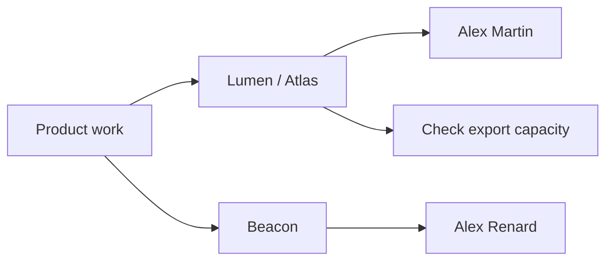

# Memory — example

**Maquette documentaire fictive.** Ces notes ont été rédigées pour illustrer
la spécification de conception V1.
Ce ne sont pas des souvenirs personnels, des fichiers à importer, ni le résultat
d’un essai du daemon. Les liens fonctionnent comme des liens Markdown ordinaires.

Le cas Atlas/Lumen reprend une trame de test, enrichie ici de personnes, de
responsabilités et d’un enseignement inventés pour la démonstration. Ces ajouts
n’ont pas été évalués. Les [sources fictives](sources.md) rendent chaque exemple
vérifiable dans cette seule maquette.

Les cinq rubriques ci-dessous sont des entrées vers les mêmes notes. Les
index transversaux offrent d’autres accès, sans dupliquer leurs faits. La
revue de couverture
examine les cas qui ne sont pas illustrés par ces sept notes.

La page de contexte
est la présentation de la fiche concernée. Lumen illustre un état, des étapes,
des raisons et une rétrospective ; Bicycle repair conserve une histoire ouverte.
Aucun de ces textes n’a été produit par REM. Sa contribution future et ses
frontières sont définies dans la spécification, pas démontrées par la maquette.

## Projects

Retrouver un résultat recherché, ses décisions et ses dépendances.

- [Beacon](capsules/theme/project/beacon.md)

## Areas

Retrouver une responsabilité ou un domaine durable et les histoires liées.

- [Product work](capsules/theme/area/product_work.md)
- Mobility : [Bicycle repair](capsules/theme/situation/bicycle_repair.md)

## Resources

Retrouver une référence ou un élément à consulter/utiliser. Aucune fiche de
ressource n’est créée dans cette maquette ; cela ne justifie pas d’y ranger
artificiellement une personne, une situation ou une leçon.

## Garden

Retrouver une idée réutilisable, avec son origine et ses limites.

- [Check export capacity](capsules/theme/knowledge/export_capacity.md)

## Archives

Retrouver une histoire close sans changer son identité ni la considérer active.

- [Lumen — formerly Atlas](capsules/theme/project/atlas_migration.md)

## Indexes

Ces raccourcis ne sont pas des rubriques de classement supplémentaires.

### People

- [Alex Martin](capsules/theme/person/alex_martin.md)
- [Alex Renard](capsules/theme/person/alex_renard.md)

### Situations

- [Bicycle repair](capsules/theme/situation/bicycle_repair.md)

### All notes

Accès indépendant du classement, y compris pour une note dont le rattachement
à une rubrique resterait incertain.

- [Beacon](capsules/theme/project/beacon.md)
- [Lumen — formerly Atlas](capsules/theme/project/atlas_migration.md)
- [Product work](capsules/theme/area/product_work.md)
- [Bicycle repair](capsules/theme/situation/bicycle_repair.md)
- [Alex Martin](capsules/theme/person/alex_martin.md)
- [Alex Renard](capsules/theme/person/alex_renard.md)
- [Check export capacity](capsules/theme/knowledge/export_capacity.md)

## Une lecture possible

Chaque lien utile est expliqué dans les notes. La page d’accueil sert à
naviguer ; les états et les raisons sont conservés dans les fiches.
