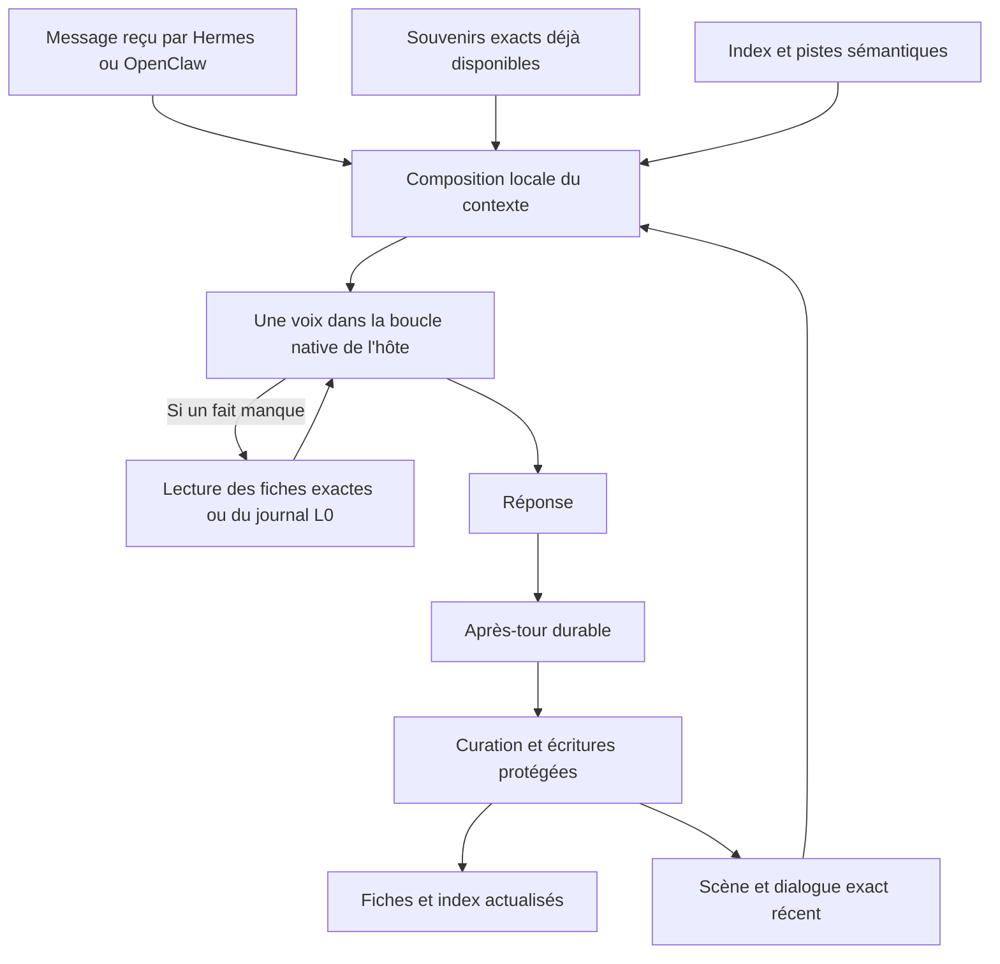

# Mémoire PARGA — guide développeur

Daemon Harness apporte une continuité personnelle à Hermes et OpenClaw : il
conserve ce qui a été confié, prépare du contexte utile et entretient la mémoire
après les réponses. L'hôte garde le modèle, la conversation, les outils et le
canal de communication. La mémoire doit rester compréhensible et modifiable
par son propriétaire, même sans le daemon.

PARGA organise cette mémoire dans cinq dossiers réels : **Projects,
Areas, Resources, Garden et Archives**. Chaque souvenir possède une seule
fiche Markdown, une identité stable, un état daté et des sources. Des liens et
des index permettent de le retrouver depuis plusieurs sujets sans le copier.

**Périmètre au 2026-10-17 :** le socle de cette structure a été fusionné sur
`main` après la validation finale du 15 octobre.
Le déplacement proposé par MemoryAgent décrit plus bas rejoint ce socle après
la qualification du 17 octobre.
Il exige `DAEMON_CORE_MEMORY_RELOCATION=v1` ; son activation reste explicite
et ne déclenche aucun reclassement de l’ancien corpus.
Les anciennes propositions de navigation par vues ont été remplacées par les
dossiers physiques. Il n'y a plus de page Home générée.

Tous les exemples ci-dessous sont fictifs. Ils illustrent les contrats ; ils
ne constituent ni des souvenirs personnels ni des résultats de tests.

Le **journal exact des conversations**, nommé `L0` dans le code, conserve les
paroles originales et leurs références de source. Une **projection** est un
état dérivé et révisable, jamais une preuve qui remplace ces sources.
Le [glossaire](glossary.md) définit les autres noms internes avant lecture
des références de code.

## 1. Le problème à résoudre

Un historique de conversation permet de retrouver des paroles, mais oblige à
reconstituer leur histoire à chaque recherche. Une collection de petits faits
isolés perd facilement leurs relations : objectif, tentatives, personnes,
raison d'un blocage et dernier état confirmé.

La fiche de contexte rassemble cette continuité autour d'un sujet cohérent.
Par exemple, une réparation conserve la panne, les essais infructueux, la pièce
attendue et la dernière nouvelle de l'atelier. Le nouveau message peut ainsi
être compris à la lumière de cette histoire, sans injecter toute la mémoire
dans chaque réponse.

La structure répond à quatre questions différentes :

| Question | Réponse dans la structure actuelle |
| --- | --- |
| Où l'utilisateur range-t-il ce souvenir ? | Un dossier physique et ses éventuels sous-dossiers. |
| De quoi parle-t-on ? | Une fiche identifiée, son type et ses liens explicites. |
| Que sait-on réellement, et à quelle date ? | Le corps Markdown, son historique et ses références exactes. |
| Comment retrouver ce souvenir maintenant ? | Le contexte déjà préparé, l'index, les pistes sémantiques et les outils de lecture. |

Le rangement facilite l'accès. Il ne suffit pas, à lui seul, à garantir que
la voix choisira le bon souvenir ou interprétera correctement une allusion.

## 2. Les inspirations et les choix propres

Le classement s'inspire de plusieurs méthodes de gestion des connaissances
personnelles, notamment PARA, IPCRA et le Zettelkasten, sans en suivre aucune
à la lettre. Ses choix viennent des besoins d'un assistant qui entretient la
mémoire après chaque échange :

- les rubriques Projects, Areas, Resources et Archives rangent selon l'utilité
  pour l'action plutôt que par thème ;
- Areas conserve aussi des relations, des préférences et des situations
  subies, sans les transformer en projets ; les rôles y sont rangés et ne
  créent pas une sixième rubrique ;
- il n'y a pas d'Inbox visible à trier, car la capture des paroles et la
  reprise des traitements possèdent déjà leurs mécanismes distincts, décrits
  plus bas ;
- Garden distingue les idées et enseignements réutilisables des références
  rangées dans Resources, et relie une idée aux contextes où elle sert par des
  liens expliqués ;
- une histoire personnelle reste une unité cohérente : on ne la découpe pas en
  une fiche par phrase ;
- le daemon ne produit pas d'idées personnelles à la place de l'utilisateur
  pour remplir Garden.

L'identité stable, les sources exactes et la révision après conversation sont
des contrats propres à Daemon Harness, pas des promesses de ces méthodes.

## 3. L'arborescence réelle

Un *vault* Obsidian est le dossier ouvert comme bibliothèque de notes. Dans
la structure à dossiers racine, son organisation est la suivante ; les sous-dossiers sont des
exemples, pas une taxonomie imposée :

```text
memory/                              racine à ouvrir dans Obsidian
├── Projects/
│   └── Work/Orion rollout.md
├── Areas/
│   ├── Work/Nora.md
│   └── Mobility/Bicycle repair.md
├── Resources/
│   └── Learning/Negotiation podcast.md
├── Garden/
│   └── Work/Small reversible pilots.md
├── Archives/
│   └── Projects/Community exhibition.md
├── .obsidian/                       réglages de l'application
└── .daemon/                         racine interne du daemon
    ├── vault-layout.json            liaison aux chemins exacts
    ├── .memory-structure-prototype.json
    ├── capsules/index.md            catalogue technique historique
    ├── levels/L0_ground_zero/       paroles exactes, par provenance
    └── users/                      contextes et états par utilisateur
```

Les cinq dossiers contiennent les **vrais fichiers faisant autorité**. Il
n'existe pas de seconde bibliothèque de ces fiches sous `.daemon`, ni de
miroir par liens symboliques. People et Situations sont des types de fiches,
pas des catégories supplémentaires à la racine. All notes n'est pas une page
à entretenir. L'explorateur Obsidian sert directement de navigation.

`.daemon` masque les éléments internes dans la navigation habituelle, mais
**ce dossier n'est pas un cache jetable** : il contient notamment le journal
exact L0 et les contextes. Les index et embeddings sont reconstructibles ;
les paroles originales ne le sont pas à partir des seules fiches. Les files,
reçus et caches peuvent aussi avoir des chemins configurés hors du vault.
Une sauvegarde complète doit tenir compte de ces différentes racines.

Le terme historique `capsule` subsiste dans certaines adresses et clés du
code, par exemple `capsule_updates`. La terminologie utilisateur est
**fiche mémoire** ou **souvenir**. Renommer ces clés techniques n'est pas
nécessaire pour bénéficier de la nouvelle organisation.

### Le rôle de chaque rubrique

| Dossier | Ce que l'on veut y retrouver | Exemple fictif et frontière |
| --- | --- | --- |
| **Projects** | Un résultat recherché : périmètre, décisions, dépendances et avancement. | Déployer Orion dans une équipe. Une envie durable de mener ce projet peut être conservée avant toute échéance ; une suggestion du daemon n'est pas un engagement. |
| **Areas** | Les cadres durables de vie, responsabilités, relations, préférences et situations. | La fiche de Nora, son rôle professionnel, une réparation en attente dans Mobility. Une routine n'est pas automatiquement un projet. |
| **Resources** | Une référence à consulter ou utiliser et l'intention qui lui est associée. | Un podcast à écouter. Sa présence ici ne prouve pas qu'il a été écouté ; elle ne déclenche pas un import de son contenu. |
| **Garden** | Une idée, un principe ou un enseignement réutilisable, confié ou adopté par l'utilisateur, qui grandit quand il y revient. Un fait de sa vie reste dans le dossier du sujet concerné. | Une réflexion sur les pilotes réversibles, reliée au projet qui l'a motivée. L'attribution et les limites restent explicites. |
| **Archives** | Une histoire passée ou explicitement inactive, encore consultable. | Une exposition terminée, avec son résultat et ses décisions. Une annulation, une pause et une réussite restent des états différents. |

Les dossiers et les nouveaux chemins proposés par le daemon utilisent des
noms anglais. Le contenu des notes peut garder la langue de la conversation,
et les noms propres sont conservés. Les sous-dossiers évoluent avec les besoins.

Un seul emplacement physique est retenu par fiche. Une personne impliquée dans
deux projets garde une fiche, liée depuis chacun d'eux. Les goûts appartiennent
à la personne concernée ; l'appartenance à un foyer ne prouve pas que chacun
est présent aujourd'hui. Ces relations doivent être écrites et étayées, pas
déduites du nom du dossier.

### Archives, clôture et Inbox

Le dossier Archives reste lisible par la bibliothèque. Archiver ne supprime
pas une histoire et n'établit pas, à lui seul, qu'un objectif a réussi. Le
silence ou l'ancienneté ne résolvent jamais un problème ouvert. Un rappel
historique ne réactive pas automatiquement un projet clos.

**Le classement peut évoluer après une nouvelle parole.** Par défaut, le
résolveur conserve l’emplacement réel, y compris après un déplacement humain.
Le curateur peut choisir Archives pour une nouvelle fiche ; changer
`memory_views` ne déplace pas un fichier.
L'état doit donc rester compréhensible dans le corps de la note, indépendamment
de son rangement. Aucun archivage par délai d'inactivité n'est ajouté.

Lorsque les transitions PARGA
sont activées, après une **nouvelle parole utilisateur**, MemoryAgent peut
proposer une `relocation` avec emplacement lu, destination, citation exacte et
raison. Il peut déplacer un projet explicitement terminé dans `Archives`, ou
la même idée devenue un engagement concret de `Garden` vers `Projects`.
Une idée réutilisable inspirant un projet distinct reste dans `Garden`.
Il ne s’agit pas d’un reclassement rétroactif de la bibliothèque.

L'absence d'Inbox visible n'élimine pas la capture : **L0** conserve exactement
les paroles, tandis que l'**outbox** conserve les obligations techniques de
traitement et leurs références. Une ambiguïté reste une inconnue ; une panne
reste un travail à reprendre. Ni l'une ni l'autre ne doit devenir un fait
inventé pour obtenir un classement. Tout échange ne mérite pas une fiche.

## 4. Le contrat d'une fiche

### Identité, emplacement et propriétés

Le nom du fichier peut changer. La propriété `memory_id` reste stable.
Pour les fiches migrées, elle conserve généralement l'ancien identifiant
technique, par exemple `theme/work/orion`, même si le fichier se trouve
désormais dans `Projects/Work/Orion rollout.md`.

| Élément | Rôle |
| --- | --- |
| `memory_id` | Identité de la fiche, indépendante de son titre et de son emplacement ; ne pas la modifier lors d'un renommage. |
| `kind` | Nature : `project`, `area`, `situation`, `person`, `group`, `organization`, `place`, `object`, `resource`, `knowledge` ou `episode`. |
| `memory_views` | Rubriques déclarées dans le format de contexte ; conservées pour compatibilité et découverte, sans autorité sur le déplacement des fichiers. |
| `memory_areas` | Domaines durables facultatifs, sous forme de libellés anglais ouverts. |
| `subjects`, `facets` | Étiquettes de découverte, utilisables dans le catalogue et la sélection sémantique ; elles ne prouvent pas une relation. |
| `aliases` | Autres noms du même sujet, préservés lors des mises à jour ; pas un moyen de fusionner des homonymes. |
| `storage_path` | Champ d'une proposition de création du curateur, par exemple `Projects/Work/Orion rollout.md` ; ce n'est pas une seconde identité. |

Les propriétés plates et les liens natifs permettent l'usage dans Obsidian
sans plugin obligatoire. Les références du format sont les
[Properties](https://obsidian.md/help/properties) et les
[liens internes](https://obsidian.md/help/links) d'Obsidian.
Les fiches historiques ne sont pas toutes réécrites pour adopter ce format.

### Exemple de fiche de projet

Exemple pédagogique ; les références de source réelles sont volontairement
absentes de cet extrait. Dans une fiche créée par le daemon, elles doivent
désigner les paroles exactes réellement reçues.

````markdown
---
memory_id: theme/work/orion
kind: project
memory_views:
  - Projects
memory_areas:
  - work
subjects:
  - orion
facets:
  - rollout
aliases:
  - Orion pilot
---
# Orion rollout

## Scope
Déployer Orion auprès de l'équipe support, en commençant par un pilote.

## Last confirmed state
Au 2026-01-12, le pilote est accepté ; sa date de lancement reste à confirmer.

## History
- 2026-01-08 : un lancement global a été envisagé.
- 2026-01-12 : l'équipe a retenu un pilote pour limiter le risque d'interruption.

## Still unknown
- Date confirmée du lancement.

## Links
- [[Areas/Work/Nora]] : responsable du suivi du pilote.
````

Pour les types `project` et `situation`, le validateur exige `Scope` et
`Last confirmed state` lorsque les propriétés de contexte sont présentes.
`History`, `Decisions`, `Still unknown`, `Links` et `Sources` sont ajoutés
lorsqu'ils ont une matière réelle. Une nouvelle fiche n'a pas à contenir un
historique vide. L'entretien préserve l'histoire utile au lieu de la remplacer
par le dernier résumé.

Les dates nouvelles utilisent `YYYY-MM-DD`, ou `YYYY-MM` / `YYYY` lorsque la
source n'est pas plus précise. Les horodatages gardent leur fuseau. La date
d'une preuve, la date d'un événement et la date de modification du fichier
ne sont pas interchangeables. Les citations historiques restent exactes.

Une page de contexte est cette fiche lisible qui conserve une histoire et ses
liens. Ce n'est pas Home, ni un second prompt système, ni une copie des faits
de toutes les notes voisines.

## 5. Comment le contexte arrive à la voix



Avant la réponse, le compositeur réunit le dialogue récent, l'état présent
déjà préparé, le profil et l'agenda utiles, les souvenirs exacts encore
disponibles et un catalogue de pistes. La scène est une lecture révisable du
présent, pas une mémoire faisant autorité. Aucun appel LLM préparatoire de
classement n'est ajouté par cette structure.

Sur le chemin sémantique nominal, des embeddings locaux — représentations
numériques de textes utilisées pour les rapprocher — proposent au plus douze
pistes à partir du message et du dialogue. Le classement utilise notamment le
corps des fiches et des descriptions portant l'identifiant, `subjects` et
`facets`. Il ne se réduit pas au nom du dossier physique. Le catalogue peut
aussi être exploré et les liens explicites servent de passages vers d'autres
fiches ; cela n'implique pas un parcours automatique de tout le graphe.

La voix juge ce qu'il faut lire. `daemon_read_souvenirs` donne accès aux
souvenirs ; `daemon_recall_l0` permet de retrouver des paroles exactes quand
nécessaire. Une piste ou un résumé d'index ne confirme jamais un fait. Si les
sources exactes sont déjà dans le contexte, une nouvelle lecture n'est pas
obligatoire. Une recherche bornée sans résultat ne prouve pas une absence.

Dans l'exemple d'une réparation de vélo, une allusion à l'atelier peut ramener
la fiche de situation et rendre disponibles les tentatives précédentes. Le
modèle doit ensuite distinguer « l'atelier a répondu » de « le vélo est réparé ».
Il n'existe pas de règle codée « atelier → Mobility ». L'intérêt attendu de la
nouvelle structure est une histoire plus cohérente et mieux reliée, à laquelle
le mécanisme de recherche existant peut donner accès.

Home n'est consulté à aucune de ces étapes. Sa suppression retire une
projection de navigation, sans supprimer les index techniques de recherche.

## 6. Qui entretient quoi après la réponse

L'adaptateur capture les tours exactement dans L0 puis remet leurs références
à une file durable. Le worker traite ces obligations dans l'ordre ; certains
travaux de projection peuvent être regroupés pendant une rafale. Le journal
et les décisions factuelles par tour gardent leurs provenances distinctes.

| Composant | Responsabilité |
| --- | --- |
| **Radar** | Juge les besoins d'entretien du tour ; tous les messages ne déclenchent pas une curation complète. |
| **MemoryAgent** | Sélectionne les sources utiles, décide de créer ou mettre à jour les souvenirs et propose leur contenu. Pour une nouvelle fiche, il choisit aussi son `storage_path` dans le même travail de fond. |
| **Écrivain commun** | Résout l'identité vers l'emplacement courant, protège la fusion, valide les chemins et le format, refuse les conflits et publie atomiquement. |
| **Temporal Curator** | Seul responsable sémantique de l'agenda personnel. Une fiche de projet ne doit pas devenir un agenda concurrent. |
| **Scene Model** | Révise l'état de travail utile au prochain échange, en conservant les sources et les inconnues. |
| **Dreaming et REM** | Entretien et rétrospective hors conversation, uniquement dans leurs périmètres activés et avec leurs protections propres. |

MemoryAgent entretient aussi une entrée de catalogue pour les fiches publiées.
Un fichier présent mais absent de l'index reste découvrable à partir de son
titre : l'index n'est pas propriétaire de l'existence d'une note. Le cache
sémantique est préchauffé en arrière-plan et peut reprendre une initialisation
interrompue. Ces mécanismes s'appliquent aussi à une bibliothèque qui se remplit
progressivement ; ils ne garantissent pas un rappel parfait dès chaque échange.

Le format ne donne pas de nouvelles responsabilités à REM. Les épisodes REM
protégés restent sous son contrôle ; ils décrivent le passé. Une rétrospective
automatique supplémentaire de chaque projet n'est pas livrée. Les dossiers
actuels fonctionnent sans cet ajout, et leur activation n'a pas déplacé les
jobs nocturnes de production vers le prototype.

La matrice des responsabilités précise les
frontières complètes. La voix ne rédige pas directement les fichiers mémoire
avec les outils de l'hôte ; elle laisse agir ce chemin canonique après le tour.

## 7. Édition humaine, déplacements et durée de vie

L'utilisateur peut lire, modifier et déplacer ses fiches dans les cinq dossiers.
Une fiche enregistrée conserve son `memory_id` ; le résolveur retrouve son
chemin réel. Une mise à jour préparée avant un renommage ne doit pas recréer
le fichier sous l'ancien nom. Si le fichier change pendant la fusion, la
publication est refusée afin de repartir d'une source actuelle.

Une note créée par l'utilisateur sans `memory_id` est lisible sans réécriture
ni provenance inventée. Son identité provisoire dépend de son chemin ; elle
est persistée lors d'une écriture canonique légitime. Avant cette inscription,
un déplacement impose une nouvelle découverte, sans restauration de l'ancien
chemin. Copier une note en conservant le même `memory_id` crée une ambiguïté :
le daemon refuse de choisir arbitrairement une copie.

Les liens entre notes suivent le format natif Obsidian. L'identité stable
protège l'accès du daemon ; elle ne répare pas tous les liens écrits à la main.
Un déplacement effectué hors d'Obsidian peut laisser des liens textuels
obsolètes. Les sources L0 masquées utilisent des liens locaux conservant leur
référence exacte ; leur ouverture peut passer par l'application Markdown du
système. Déplacer tout le vault demande un raccordement des racines, pas
seulement un changement de chemin dans l'explorateur.

La pérennité repose sur les fichiers lisibles, les identités stables, les
sources et une restauration vérifiée. Elle ne repose pas sur un graphe très
dense : chaque lien doit être utile et justifié. Les rubriques ne sont pas des
droits d'accès ; séparer Work et Family ne crée aucun cloisonnement de sécurité.
Archives n'est pas non plus un mécanisme d'effacement des sources ou sauvegardes.

Pour ces transitions, le publieur commun garde `memory_id`, le nom
de fichier et les octets issus de la fusion protégée. Il corrige mécaniquement
les adresses des liens entrants et sortants vers les mêmes fichiers. Une
édition ou un déplacement pendant la décision invalide la proposition.
Le journal privé permet de reprendre une interruption sans nouvel arbitrage
LLM ; il ne peut rejouer que les transformations de liens attendues. Les
copies de travail du journal disparaissent après le reçu final. Aucun réglage
Obsidian, fait d’un épisode REM ou journal L0 n’est rédigé pour réaliser le
déplacement. Le code est dans
[`memory/note_relocation.py`](../src/daemon_core/memory/note_relocation.py).

## 8. Repères pour intervenir dans le code

Les liens suivants visent la révision documentée, car plusieurs de ces modules
n'existent pas encore sur `main`.

| Point d'entrée | Ce qu'il faut y comprendre |
| --- | --- |
| [`memory/library_layout.py`][layout] | Racine du vault, découverte des fichiers, `memory_id`, résolution des chemins, liens et refus des ambiguïtés. |
| [`memory/context_pages.py`][pages] | Types et sections de fiches, activation isolée, règles des dossiers physiques, absence de génération Home. |
| [`memory/obsidian.py`][obsidian] | Syntaxes de liens et propriétés natives ; compatibilité avec les formes historiques. |
| [`memory_agent.py`][agent] | Jugement du curateur, création, fusion, publication protégée et entretien du catalogue. |
| [`memory/reader.py`][reader] | Lecture exacte, catalogue, découverte hors index et zoom par liens. |
| [`semantic_atlas.py`][atlas] | Construction des représentations, classement des pistes, cache et préchauffage. |
| [`memory/root_migration.py`][migration] | Migration sur copie : décisions de placement séparées de la conservation mécanique du contenu et des liens. |
| [`tests/test_memory_root_folders.py`][tests] | Cas exécutables : renommage, édition concurrente, suppression, identité dupliquée, chemins et migration. |

Deux racines doivent être distinguées : le vault ouvert dans Obsidian et
`DAEMON_CORE_MEMORY_ROOT`, qui vise son dossier `.daemon`. Le format de contexte
requiert `DAEMON_CORE_MEMORY_STRUCTURE=v1` avec un marqueur lié à la racine
exacte ; le format Obsidian possède `DAEMON_CORE_OBSIDIAN_FORMAT=1`.
`vault-layout.json` reconnaît séparément le stockage physique `root-folders-v1`
et lie les deux racines. Un drapeau seul ne migre pas une bibliothèque.

Hermes et OpenClaw passent par ce noyau commun. Leurs plugins adaptent le
transport et les outils mémoire ; ils ne possèdent pas deux taxonomies ou deux
versions de l'écrivain. Leur code source natif reste inchangé.

Pour contribuer, partir d'un état synthétique isolé et des tests du module
concerné. Préserver les sources et les modifications humaines, puis vérifier
les deux hôtes lorsque le contrat commun change. Un développeur ne doit pas
fabriquer une fiche attendue dans la mémoire personnelle pour faire réussir
un rappel. Une réparation factuelle passe par le mécanisme corrigé et, si
nécessaire, un rejeu autorisé des paroles originales.

## 9. Ce qui est vérifié et ce qui reste ouvert

Les essais des dossiers physiques
ont vérifié des lectures et créations natives sur les deux hôtes, un entretien
après déplacement et la conservation des sources pendant la migration. Le
retrait de Home a ensuite été
activé sur le prototype. Les rapports conservent leurs incidents et mesures ;
ce guide n'annonce pas une nouvelle campagne d'essais.

La structure est utilisable, mais quelques limites doivent guider les travaux :

- La couverture sur dix ans, le très grand volume et la supériorité générale
  du rappel ne sont pas démontrés. Les mesures ponctuelles ne prouvent pas un
  gain général de latence ou de tokens.
- Le classement initial, la qualité d'une fiche et la décision de la lire
  restent des jugements du modèle. Le code protège les opérations, pas leur
  pertinence sémantique.
- Le déplacement après une nouvelle parole exige une activation explicite.
  L’archivage par ancienneté,
  le reclassement rétroactif et la rétrospective REM par projet ne sont pas ajoutés.
- Certaines métadonnées REM historiques imbriquées restent conservées ; leur
  affichage complet dans les Properties d'Obsidian n'est pas garanti.
- La migration et la restauration complète d'un vault restent des opérations
  coordonnées. Ni copier les seuls cinq dossiers, ni reconstruire les embeddings
  ne restaure à lui seul la continuité entière.

Pour approfondir, lire les invariants d'architecture,
la recette de qualité, le
rapport d'initialisation de l'index
et le contrat des dates.
Les propositions initiales expliquent
la réflexion historique ; pour l'arborescence actuelle, leurs notions de vues,
Home et chemins fixes sont remplacées par les contrats décrits ici.

[prototype]: ../README.md
[layout]: ../src/daemon_core/memory/library_layout.py
[pages]: ../src/daemon_core/memory/context_pages.py
[obsidian]: ../src/daemon_core/memory/obsidian.py
[agent]: ../src/daemon_core/memory_agent.py
[reader]: ../src/daemon_core/memory/reader.py
[atlas]: ../src/daemon_core/semantic_atlas.py
[migration]: ../src/daemon_core/memory/root_migration.py
[tests]: ../tests/test_memory_root_folders.py
